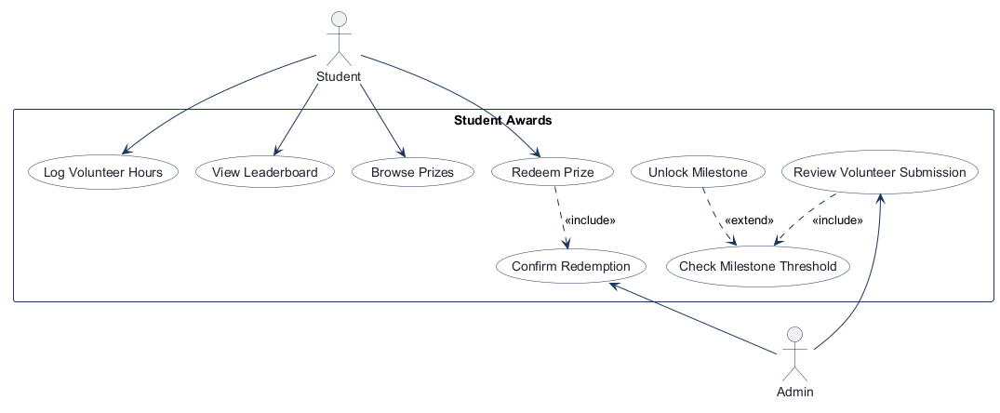
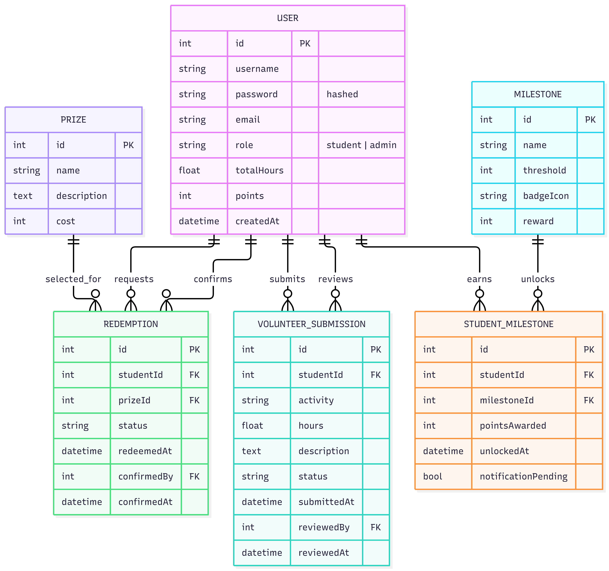
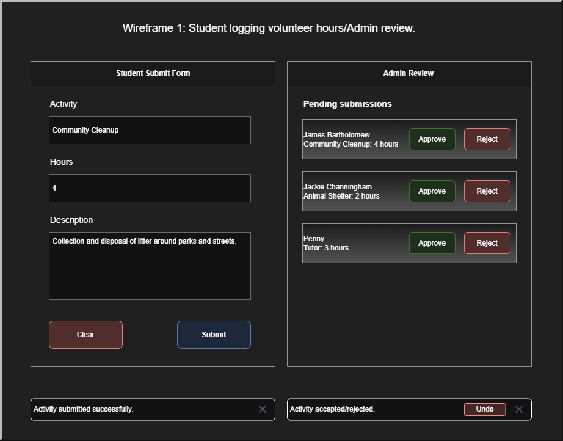
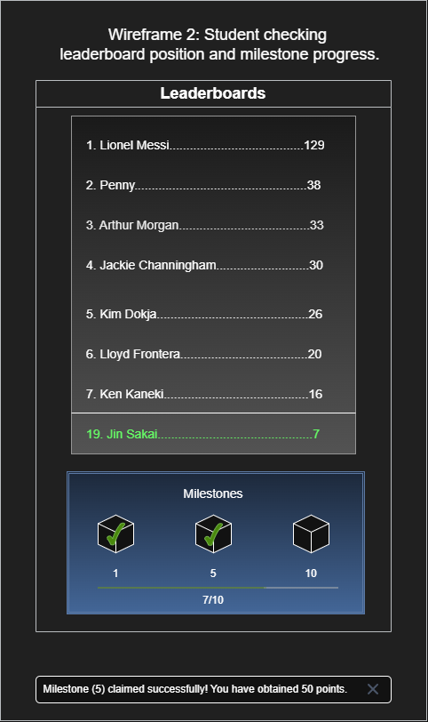
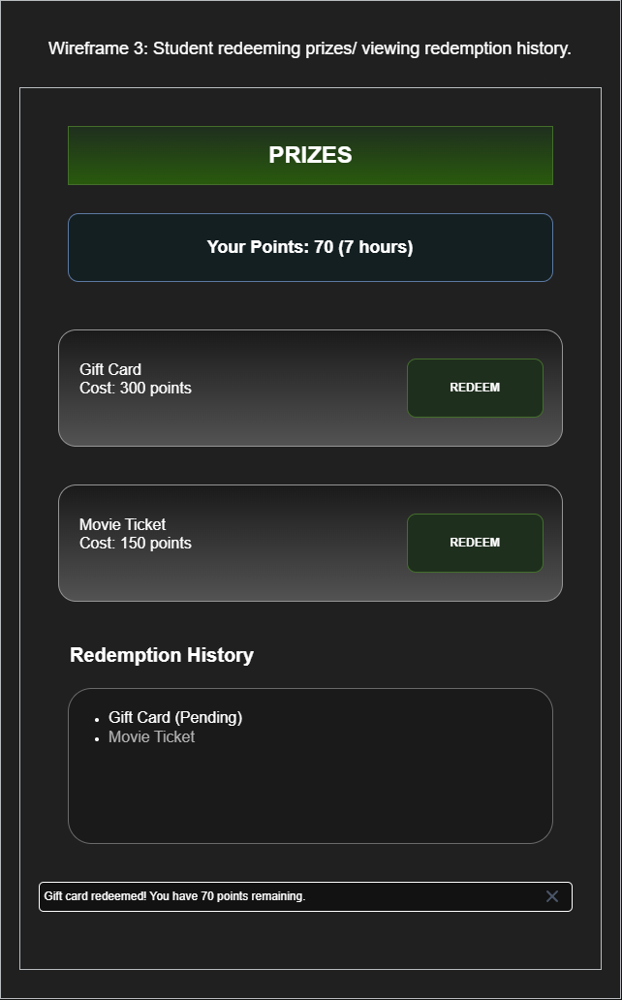

<!-- student-build:skill-integrity
status: pass
root: e84cd692d0b85eefe546385661958c27d07e8be6c5176a82012f68ccff5c8beb
expected_root: e84cd692d0b85eefe546385661958c27d07e8be6c5176a82012f68ccff5c8beb
mismatches: none
-->

# COMP 3613 Assignment 1

Draft this file with the Guide. **Update it after every phase milestone** before you pause. The use-case diagram is a UML PNG at `docs/diagrams/use-case.png`, linked from this file as `diagrams/use-case.png` (path relative to `docs/report.md`). The model diagram is Mermaid. **Embed wireframe images** as `wireframes/<file>` (files live in `docs/wireframes/`).

Do not put your student ID in this file if you will commit it. The PDF cover adds your name and ID at export time.

## Assigned project
Student Awards (incentive system)

## Three workflows

### 1. Log Volunteer Hours (Student + Admin)
The student submits a volunteer activity and hours worked. An admin reviews the submission and approves or rejects it.

**Done:** Approved hours appear in the student's total and the leaderboard is updated.

### 2. View Leaderboard & Unlock Milestones (Student)
The student opens the leaderboard page and sees all students ranked by approved hours. When the student's total crosses a milestone threshold, the milestone unlocks.

**Done:** The milestone badge is visible on the student's profile and the leaderboard reflects current standings.

### 3. Redeem Points for Prize (Student + Admin)
The student browses available prizes they can afford and selects one. The system deducts points and creates a redemption request. An admin confirms the redemption as fulfilled.

**Done:** Points are deducted, the prize is marked claimed, and redemption history is visible to both the student and admin.

## Use case diagram

Phase 2 notes: Student and Admin are the actors. Review Volunteer Submission includes Check Milestone Threshold, and Unlock Milestone extends that check only when the threshold is crossed. Redeem Prize includes Confirm Redemption. The approval result remains part of Log Volunteer Hours.

## Model diagram

Phase 3 first draft. `StudentMilestone` records which milestones each student has unlocked; a student can unlock each milestone at most once.

Relationship and business-rule notes: each volunteer submission belongs to one student and may be reviewed by one admin; each redemption belongs to one student and one prize and may be confirmed by one admin. `reviewedBy` / `reviewedAt` and `confirmedBy` / `confirmedAt` are assumed unset while their records are pending. `StudentMilestone` should enforce uniqueness on `(studentId, milestoneId)`. Approved submissions contribute to `User.totalHours`; redemptions spend points. Prizes have no stock limit, per the revised wireframe.

## Wireframes

### Log Volunteer Hours

### View Leaderboard & Unlock Milestones

### Redeem Points for Prize

`python manage.py report` also embeds any PNG/JPG still missing from `docs/wireframes/`.

## Theming

Dark Student Awards theme: black and charcoal surfaces with white text, green success/approve/submit actions, red reject/cancel/undo actions, and a clean sans-serif typeface. Applied to the landing, login, and register pages; shared brand tokens and the authenticated shell use the same palette. The wordmark is plain text: Student Awards.

## Implementation notes

One named workflow at a time. Include verify notes and polish / model revisions (Phase 5). Do not treat the first build as final.

Phase 5, theming and workflow 1 implementation: applied the requested palette and sans-serif type to public/auth pages and the authenticated shell. The wireframe's Activity field was added to `VolunteerSubmission`; the student completed the SQLModel field and thin route snippets. Volunteer submission, admin approve/reject, approved-hour totals, undo actions, My Activities history, digit-only hours, live queue removal, bottom toasts, and landing/sign-out navigation are implemented. My Activities has All/Pending/Accepted/Removed filters; its default unfiltered list groups pending first, then remaining statuses by recency. Approved hours are aggregated from approved submissions rather than stored redundantly on User. Follow-up polish repaired shared shell markup, made toast visibility independent of Bootstrap's toast plugin, guarded optional toast controls so missing Undo markup cannot abort form/review handlers, added a dedicated toast-visible state above the viewport bottom, and reconnected `/app` and `/admin` to the activity screen with review/history endpoints. Responsive polish hides the sidebar off-canvas on mobile behind the hamburger/backdrop, uses full-width content and stacked forms/cards, wraps leaderboard names, prevents page-level horizontal overflow, and enforces 44px mobile touch targets. The later Phase 6 confirmation states all three workflows work locally.

Phase 5, workflow 2: milestones are seeded at 1, 5, 10, then every 10 through 100 hours, awarding 10 points per threshold. Admin approval persists each newly reached unlock; its notification is shown to the student on the next leaderboard visit. The leaderboard ranks by approved hours and initially shows the top nine plus a pinned current-user row when their rank is lower; the pin hides when their actual row enters the scroll window. With fewer than ten students, all ranks appear without a pin. In-box up/down controls jump to the current user's real rank, podium icons mark positions 1-3, and dotted row leaders are removed. The leaderboard also displays star milestone badges/progress. The milestone carousel initially shows the next target with the two latest unlocks (or the first three when fewer than two are unlocked); it fills the panel with three evenly spaced items, slides the tiles as a single track via arrows and mouse-drag/touch-swipe, and reveals an icon return control beneath it after moving away from the starting window. Approved hours and points are derived; milestone reward amounts and notification state are persisted on `StudentMilestone`. Star icons appear immediately after point totals and costs throughout the student UI. Student verified: submitted hours, admin approval, next-visit milestone toast, and updated total all worked.

Phase 5, workflow 3: the no-stock prize catalog includes Coffee Voucher (50), $10 Amazon Gift Card (200), Campus Water Bottle (400), Movie Ticket (600), Campus Hoodie (1,000), and Laptop (5,000). All prizes remain visible; Redeem is disabled when the student's available points are insufficient. Redemption immediately deducts its cost and appears in student/admin history. Admins manage each request through Pending, Processing, Shipping, and Delivered statuses; students see the current status in their history. Status badges are red, orange, yellow, and green respectively; the admin sees a color-only badge beside the selected dropdown value. Delivered records store the confirming admin and timestamp. Points are derived from approved hours and milestone rewards less redemption costs.

<!-- student-build:code-check
workflow: Log Volunteer Hours
check: SQLModel snippet in app/models/volunteer_submission.py
passed: yes
architecture_ok: yes
note: Student added the Activity field alongside the submission fields.
-->
<!-- student-build:code-check
workflow: Log Volunteer Hours
check: thin route snippet in app/routers/volunteer_hours.py
passed: yes
architecture_ok: yes
note: Route constructs the service/repository and delegates submission creation without persistence logic.
-->
<!-- student-build:code-check
workflow: View Leaderboard & Unlock Milestones
check: SQLModel snippet in app/models/milestone.py
passed: yes
architecture_ok: yes
note: Student added the integer reward field for each milestone.
-->
<!-- student-build:code-check
workflow: View Leaderboard & Unlock Milestones
check: thin route snippet in app/routers/leaderboard.py
passed: yes
architecture_ok: yes
note: Student route obtains leaderboard data through the service and renders the template.
-->
<!-- student-build:code-check
workflow: Redeem Points for Prize
check: SQLModel snippet in app/models/prize.py
passed: yes
architecture_ok: yes
note: Student added the integer points cost field.
-->
<!-- student-build:code-check
workflow: Redeem Points for Prize
check: thin route snippet in app/routers/prizes.py
passed: yes
architecture_ok: yes
note: Student calls the prize service and returns a JSON result without persistence logic in the route.
-->

## Deployed app

Phase 6. Public Render URL (not localhost). Markers open this to mark the three workflows.

https://faststarter-oe83.onrender.com/

GitHub: https://github.com/Floronix/comp3613a1

Final report check (2026-10-11): the service is active and `/health` returns `{"ok":true}`. Render lists the Postgres instance as available and showed 1-2 recent active connections. The health endpoint does not test database connectivity; the current `DATABASE_URI` binding could not be confirmed because the Render MCP does not expose the service's environment-variable keys and its direct Postgres query is blocked by the empty external IP allowlist. Confirm the internal database URL is configured in Render before treating Phase 6 as fully verified.

## Logins

Every account a marker needs, including extra users you added. Starter accounts:

- bob / bobpass — regular user
- admin / adminpass — admin

(filler accounts for leaderboard, in case they're required)
- jill / jillpass
- jane / janepass
- jake / jakepass
- jack / jackpass
- barty / bartypass
- anna / annapass
- alex / alexpass
- bobby / bobbypass

## YouTube URL

https://www.youtube.com/watch?v=MkHuTACd6yU

## Session transcripts

Filled when the Guide builds the report: the agent writes chat markdown into `docs/transcripts/`; `python manage.py report` packages them.

Guide packaged **7** chat(s) in `docs/transcripts/` (and `docs/transcripts.zip`).

Index: [docs/transcripts/INDEX.md](transcripts/INDEX.md)

- [`phase-1-initial-draft`](transcripts/phase-1-initial-draft.md)
- [`phase-1-project-and-workflows`](transcripts/phase-1-project-and-workflows.md)
- [`phase-2-use-case`](transcripts/phase-2-use-case.md)
- [`phase-3-erd`](transcripts/phase-3-erd.md)
- [`phase-5-build-polish`](transcripts/phase-5-build-polish.md)
- [`phase-6-render-deploy`](transcripts/phase-6-render-deploy.md)
- [`report-build-2026-10-11`](transcripts/report-build-2026-10-11.md)

## Competency (student-judge)

Filled by Guide from the student-judge run when this report was built.

**Judged at:** 2026-10-11T19:38:28-04:00
**Student / session:** Student Awards; GitHub Copilot Agent sessions for this workspace
**Artifact:** Re-read native Copilot chats available for this workspace, current `docs/report.md`, diagrams, wireframes, and the seven Guide-written Markdown chat records; no prior scorecard used as evidence.
**Phases in evidence:** 1-6 (COMP 3613; Phase 5 includes polish, Phase 6 is deploy)

### Totals
| | Count / value |
|--|--|
| Metrics on rubric | 12 (M1-M12) |
| N/A (excluded) | 0 |
| Metrics scored | 12 |
| Scoreable max | 48 |
| Awarded total | 44 / 48 |
| **Overall (avg of scored)** | **3.7 / 4** |
| Impression mark | 18 / 20 |

## Scorecard

| ID | Metric | Score / 4 | In avg | Evidence |
|----|--------|----------:|:------:|----------|
| M1 | Phase discipline | 3 | yes | Separate Phase 1-3 chats and a Phase 5 workflow-by-workflow build precede the Phase 6 request. The Phase 1 report omission was corrected after the student flagged it. |
| M2 | Problem framing | 4 | yes | Student named three workflows and supplied detailed outcomes; in Phase 2: "the system always checks the threshold after approval, and unlocks the milestone only if it's crossed." Student supplied the Phase 3 entity list and confirmed one-time milestone unlocks. |
| M3 | Decision ownership | 4 | yes | Student chose no prize stock limits, milestone rewards/timing, prize/status rules, leaderboard behavior, and repeated UI refinements. Example: "No, the tiles themselves need to slide. Not just the numbers changing. Like a carousel." |
| M4 | Artefact-before-code | 3 | yes | Current report contains the ERD, the UML use-case image, and three wireframe embeds; Phase 5 starts from those named wireframes and the student directs model/UI revisions. No standalone Phase 4 chat was recoverable. |
| M5 | Verification habit | 3 | yes | Student identified observed errors and reported workflow 2 working after approval/unlock. The Phase 6 prompt says: "All three workflows work locally," superseding the earlier pending note about one responsive pass. |
| M6 | Assignment fit | 4 | yes | All six Phase 5 model/route code-check markers say `architecture_ok: yes`; a scan of `app/routers/` found no `select`, `db.exec`, or `session.query`. The report reflects the wireframes and selected no-stock/status rules. |
| M7 | Slice explanation | 3 | yes | Student completed the model and thin-route snippet checks recorded for all three workflows. The report notes the student added Activity, milestone reward, and prize cost fields; the student also explained concrete mismatches during iteration. |
| M8 | Prompt quality | 4 | yes | Prompts are phase-tagged and increasingly concrete. Examples include the initial `Feature (user)` workflows, the Phase 2 relationship answers, and detailed leaderboard/mobile requirements. |
| M9 | Response to pushback | 4 | yes | Student kept testing and refining after early builds, reporting toast failures, a route error, carousel mismatch, icon sizing, responsive issues, and corrected status wording rather than accepting the first build. |
| M10 | Integrity | 4 | yes | No answer-seeking, paste-back, or transcript-gaming signal found. `python manage.py skills-verify` passed: all protected skill files match `.agents/skills.lock.json`. |
| M11 | Provenance continuity | 4 | yes | Decisions develop consistently from Student Awards workflows to the ERD, wireframes, implementation checks, polish notes, and deployment. No orphan product/schema appeared. |
| M12 | Sincerity trajectory | 4 | yes | No suspicion was opened and no sincerity blocks were found; there was no suspicion spiral to abandon. |

## Strengths
- Student owns the workflows, entities, relationships, and visible behavior, including repeated post-build polish.
- Verification feedback was specific enough to drive fixes; the student confirmed workflow 2 and later reported all workflows working locally.
- The recorded model and thin-route snippets respect the layered architecture, and the protected course skills are intact.

## Gaps (priority order)
1. **Phase 6 database binding is not conclusively verified.** The Oct 6 Guide chat said `DATABASE_URI` was unset. The current Render service is live and not suspended, Postgres is available, and metrics show 1-2 recent active connections. `/health` returns `{"ok":true}` but is liveness-only. The MCP does not expose the service's environment-variable keys, and a direct database query is blocked by the empty external IP allowlist, so the current connection cannot be confirmed from this pass.

## Phase gate status
| Phase | Status | Note |
|-------|--------|------|
| 1 | met | Project and three detailed workflows recorded after the student corrected an incomplete first draft. |
| 2 | met | Include/extend and approval outcome decisions recorded; UML PNG and relative report link are present. |
| 3 | met | Student supplied entities/properties and confirmed the one-time student-milestone relationship. |
| 4 | met | Three readable wireframes exist and are embedded in the report; no separate Phase 4 native chat was found. |
| 5 | met | Theming, per-workflow code checks, verification, and substantial UI/workflow polish are documented; this was not a first-build-only session. |
| 6 | partial | Service and Postgres are live/available; recent DB activity is visible, but current `DATABASE_URI` binding is not directly inspectable. Confirm it in the Render dashboard before submission. |

## Recommended next practice
- Confirm the `DATABASE_URI` key points to the internal Postgres URL in Render, then verify database-backed data persists across a service restart.

## Integrity note
- Clean. No laundering indicators found. Protected-skill verification passed.

## Provenance flags
- No integrity flags. One early Phase 1 archive contains Guide turns without recoverable student turns; the subsequent Phase 1 chat contains the student's project and workflow prompt. No separate Phase 4 chat was present in the accessible history; the report and wireframe files provide the Phase 4 artefact evidence.

## Sincerity log summary
- Blocks found: 0 | max round: none | min/mean/final confidence: N/A | trend: none | cleared: yes (no suspicion opened)

## Skips
- Skips: 0/3 used.

## Skill integrity

Course skills are hashed at export and compared to `.agents/skills.lock.json`. Do not edit `.agents/skills/`, `.cursor/skills/`, or `AGENTS.md`.

- Status: **pass**
- Root: `e84cd692d0b85eefe546385661958c27d07e8be6c5176a82012f68ccff5c8beb`
- none
